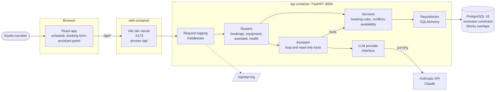
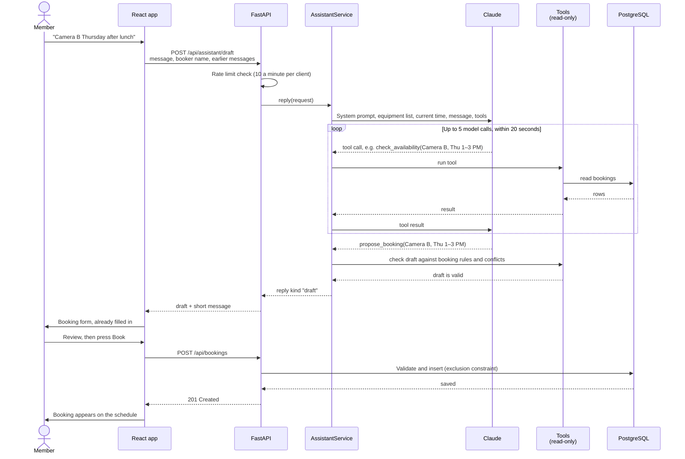

# Halftone Booking - Impruve Build Challenge

Equipment booking for the Halftone studio: see who has which camera, light or room, book it, and never double-book. Members can book with a form or just ask the AI assistant in plain English ("Camera B Thursday after lunch").

- **Backend:** Python 3.12, FastAPI, SQLAlchemy 2, Alembic, PostgreSQL 16
- **Frontend:** React 18 + TypeScript, Vite, TanStack Query, Tailwind
- **AI assistant:** Claude (Sonnet by default) through the Anthropic API
- **Style:** every change follows [CODE-STYLE.md](CODE-STYLE.md) (Black for Python, Prettier for TypeScript)

## Run it locally

### 1. Install what you need first

| Tool                                | Why                                                                              | How to get it                                                                                                                                                                       |
| ----------------------------------- | -------------------------------------------------------------------------------- | ----------------------------------------------------------------------------------------------------------------------------------------------------------------------------------- |
| **Git**                             | To clone the repo                                                                | [git-scm.com](https://git-scm.com/downloads)                                                                                                                                        |
| **Docker** with Compose v2          | Runs the database, API and web app                                               | [Docker Desktop](https://www.docker.com/products/docker-desktop/) on Mac and Windows; on Linux, Docker Engine plus the `docker-compose-plugin` package                              |
| **make**                            | Short names for the project's commands                                           | macOS: `xcode-select --install`. Linux: `sudo apt install make` (or your distro's package). Windows: run everything inside [WSL 2](https://learn.microsoft.com/windows/wsl/install) |
| An **Anthropic API key** (optional) | Turns on the AI assistant. Without one the app works and the assistant is hidden | [console.anthropic.com](https://console.anthropic.com/settings/keys)                                                                                                                |

That's all for the Docker setup. You only need [uv](https://docs.astral.sh/uv/getting-started/installation/) and [Node 22](https://nodejs.org/) if you want to run the API and web app outside Docker, or run the tests and linters.

Make sure Docker is running before you go on (`docker compose version` should print a version).

### 2. Clone the repo

```sh
git clone https://github.com/nick-esqueda/halftone-booking.git
cd halftone-booking
```

### 3. Add your API key (optional)

```sh
cp .env.example .env
```

Open `.env` and paste your key after `ANTHROPIC_API_KEY=`. Skip this step to run without the assistant.

### 4. Start the app

```sh
make up
```

The first run builds the Docker images and takes a few minutes. When the log settles, open **http://localhost:5173**.

On start the API applies the database migrations, adds the studio's equipment (Cameras A–C, Lighting Kits 1–4, Podcast Room) and, if there are no bookings yet, fills the next two months with random demo bookings. Code changes in `backend/app` and `frontend/src` reload automatically.

Handy addresses:

- App: http://localhost:5173
- API docs (Swagger): http://localhost:8000/docs
- Postgres: `localhost:5432`, user `postgres`, password `postgres`, database `booking`

### Stop and reset

- `Ctrl+C` in the `make up` terminal, or `make down` from another one, stops everything. Your bookings are kept.
- `docker compose down -v` stops everything **and deletes the database**. The next `make up` starts fresh, with new demo bookings.
- To start with no demo bookings, set `BOOKING_SEED_DEMO_BOOKINGS=false` in `.env` and reset the database.

### If something goes wrong

- **Port 5432 is already in use** (you have Postgres installed locally): set `DB_PORT=5433` in `.env`. The app and API ports (5173 and 8000) must be free.
- **`docker: command not found` or "Cannot connect to the Docker daemon"**: start Docker Desktop (or `sudo systemctl start docker` on Linux) and try again.
- **The assistant panel doesn't appear**: the API didn't get an API key. See the next section.

### Run the API and web app without Docker

Postgres still runs in Docker; the API and web app run directly on your machine. You need uv and Node 22.

```sh
make install       # Python and Node dependencies
make dev-native    # starts Postgres in Docker
make api           # terminal 1: migrations, seed data, then the API on :8000
make web           # terminal 2: the web app on :5173
```

Run `make help` to see every command.

## Use a different Anthropic API key

The API reads the key from `ANTHROPIC_API_KEY`. Both ways of running the app (`make up` and `make api`) read it from `.env` in the repo root.

**To switch keys:** change `ANTHROPIC_API_KEY` in `.env`, then restart: `Ctrl+C` and `make up` again (or `Ctrl+C` and `make api`). Docker Compose recreates the API container with the new key.

**To try a key for one run only**, without editing `.env`, pass it after the command:

```sh
make up ANTHROPIC_API_KEY=sk-ant-...
make api ANTHROPIC_API_KEY=sk-ant-...
```

Put it **after** `make`, not before. `ANTHROPIC_API_KEY=... make up` is overridden by the value in `.env`, even an empty one.

**To check it took:** http://localhost:8000/api/config shows `"assistant_enabled": true`. That only means a key is set; if the key itself is wrong, the assistant replies that it can't be reached right now.

**To switch the assistant off,** leave `ANTHROPIC_API_KEY` empty. The UI hides the assistant and booking by form still works.

Related settings, also in `.env`:

| Setting              | Default             | What it does                                                           |
| -------------------- | ------------------- | ---------------------------------------------------------------------- |
| `BOOKING_LLM_MODEL`  | `claude-sonnet-5-5` | Which Claude model the assistant uses                                  |
| `BOOKING_LLM_EFFORT` | `low`               | How hard the model thinks: `low`, `medium` or `high`. Higher is slower |

The assistant evals (`make evals`) and the **Assistant evals** GitHub workflow use a key too: locally the same `.env` key, in CI the repository secret `ANTHROPIC_API_KEY` (Settings → Secrets and variables → Actions). Evals call the real model, so each run costs money.

## Features

### Schedule

- **Day timeline.** Each piece of equipment is a row, with the day's hours running left to right and bookings drawn as bars. Hover over a bar to see who booked it and why, or click it to open the booking. A line marks the current time.
- **Day tabs.** Pick a day of the week, or step to the previous or next week.
- **Category filter.** Show only cameras, lighting or rooms.
- **Studio hours or all day.** Show 7 AM–10 PM (the default) or all 24 hours. Your choice is remembered, and a hint counts bookings hidden outside the hours shown.
- **Multi-day bookings.** Bookings that span days show their weekdays and a ‹ or › edge where they carry on into the day before or after.
- **Click to book.** Click an empty spot on a row to start a booking for that item and time.

### Booking

- **One booking, many items.** A booking is one time range for one or more items, with the booker's name and a purpose.
- **No double-booking.** The database itself refuses two active bookings of the same item at overlapping times. The booking form marks items that are already taken with who has them and when, and if you book one anyway, nothing is saved and the clashing item is highlighted.
- **Rules checked by the API.** Times land on 15-minute steps, a booking lasts at most 7 days, can't start in the past (beyond a 5 minute grace period), and names and purposes have length limits. The UI gives quick hints, and the API checks everything again.
- **Edit and cancel.** Change the items or times, or cancel. If someone else changed the booking while you had it open, you're told instead of overwriting their change.
- **History.** Each booking shows who booked, changed or cancelled it, and when.
- **My bookings.** A page listing your upcoming and past bookings.

### People and time

- **"Booking as" name.** There are no accounts yet: you type your name in the top bar and the browser remembers it. If it's nearly, but not exactly, a name already used on bookings, the app asks "Did you mean …?" to catch typos.
- **Studio time.** Every time is shown and entered in the studio's time zone (Central, `America/Chicago`), whatever your device's zone. People in other zones get a "that's … your time" hint.
- **Light and dark themes,** dark by default.
- **Friendly errors.** If the API or database is down, the page says so and offers a retry instead of breaking.

### AI booking assistant

- **Book in plain English.** "Camera B Thursday after lunch" opens the booking form already filled in. Nothing is saved until you press Book.
- **Change or cancel by asking.** "Move my podcast room booking to 3 PM" or "cancel my Friday booking" finds the booking and opens the change or cancel for you to confirm.
- **Asks instead of guessing.** A vague request ("Friday's shoot") gets the free time ranges for that day to pick from.
- **Knows the studio's phrases.** "After lunch" is 1 PM, "morning" is 9 AM to noon, "end of day" is 5 PM.
- **Remembers the conversation,** shows who asked each question, and scrolls long chats.
- **Read-only model.** The model can only look things up and propose; every draft is checked with the same booking rules as the form.
- **Limits.** Each request is capped at 5 model calls and 20 seconds, and each client at 10 requests a minute, so a confused model can't run up cost.

### Behind the scenes

- **Logging with request IDs.** Every response carries an `X-Request-ID`, every error body includes it, and every log line is tagged with it. See [Logging](#logging).
- **Demo data.** A fresh local database gets realistic random bookings, so the schedule isn't empty.
- **Swappable model provider.** The assistant talks to an `LLMProvider` interface; Anthropic is the one provider today.

## Architecture



- **Layers.** Routers handle HTTP, services hold the business rules, repositories talk to the database. The assistant's tools call the same services, so a draft from the assistant passes exactly the checks a form submission does.
- **Time lives on items.** A booking is who and why; its items hold the time range and cancelled flag. The booking's overall time and status are worked out from its items (in `app/services/booking_times.py`).
- **No double-booking** is enforced by a Postgres exclusion constraint on `booking_items`: two active items for the same equipment can't overlap. The API checks first so it can name the clash, and turns a lost race into the same 409.
- **Studio time.** The API stores UTC; the UI converts to and from the studio's time zone.
- **API types.** The frontend's TypeScript types are generated from the API's OpenAPI schema (`make openapi`).

### How an AI booking request flows



The model ends each request with one of four final tools: `propose_booking`, `propose_change`, `propose_cancel`, or `ask_user` (for vague requests, with suggested times). Along the way it can call `check_availability`, `find_free_times` and `find_bookings`. None of them write. If the model runs out of calls or time, the person gets a "try naming the item, day and time" reply.

## Repo layout

```text
halftone-booking/
├── Makefile                 # Every common command; `make help` lists them
├── docker-compose.yml       # Local stack: db, api, web, with hot reload
├── .env.example             # Settings to copy into .env
├── CODE-STYLE.md            # How code in this repo should read
├── .github/workflows/
│   ├── ci.yml               # Lint, types, tests, e2e, Docker builds on every PR
│   └── evals.yml            # Assistant evals against the real model (paid, opt-in)
├── backend/                 # Python FastAPI API
│   ├── app/
│   │   ├── main.py          # App setup: routers, middleware, error handlers
│   │   ├── config.py        # Every setting (BOOKING_* environment variables)
│   │   ├── models.py        # SQLAlchemy tables
│   │   ├── schemas.py       # Request and response models
│   │   ├── routers/         # HTTP endpoints
│   │   ├── services/        # Booking rules, conflicts, availability
│   │   ├── repositories/    # Database queries
│   │   ├── assistant/       # AI assistant: loop, tools, prompt, providers, rate limit
│   │   ├── observability/   # Logging, request IDs, log sinks, redaction
│   │   ├── seed.py          # Seeds equipment (and demo bookings)
│   │   ├── demo_bookings.py # Random demo bookings for local use
│   │   └── studio_time.py   # Studio time zone helpers
│   ├── migrations/          # Alembic database migrations
│   ├── evals/               # Assistant eval cases and runner (see its README)
│   ├── scripts/             # export_openapi.py, for the frontend's API types
│   └── tests/               # pytest: API, rules, concurrency, assistant
├── frontend/                # React + TypeScript web app
│   ├── src/
│   │   ├── App.tsx          # Top bar and routes
│   │   ├── pages/           # Schedule and My bookings
│   │   ├── features/        # One folder per feature:
│   │   │   ├── availability/  #   day timeline, day tabs, filters, hour range
│   │   │   ├── bookings/      #   booking form, dialog, history, cancel
│   │   │   ├── assistant/     #   assistant panel and conversation
│   │   │   ├── identity/      #   "Booking as" name and typo hint
│   │   │   ├── studio/        #   studio time and local-time hints
│   │   │   └── theme/         #   light and dark theme
│   │   ├── components/ui/   # Shared buttons, dialogs, error banners
│   │   ├── api/             # API client and generated types (schema.d.ts)
│   │   └── config/          # UI constants
│   └── e2e/                 # Playwright tests
└── logs/                    # API log files (git-ignored)
```

## Test and check

```sh
make check     # Black, ruff, mypy, Prettier, ESLint, tsc, pytest, Vitest
make e2e       # Playwright tests; needs the app running (make up)
```

These need uv and Node 22 (`make install` first). Backend tests need Postgres: they use the `booking_test` database on localhost by default (start it with `make dev-native`); set `TEST_DATABASE_URL` to point elsewhere. Postgres is required, not SQLite, because the rule that blocks double-booking is a Postgres exclusion constraint.

CI runs all of the above on every pull request, checks that the generated API types are up to date, and builds the Docker images. After changing the API, run `make openapi` to regenerate `frontend/src/api/schema.d.ts`.

The assistant's evals in `backend/evals/` grade the real model's choices; see [its README](backend/evals/README.md). They cost money, so CI runs them only by hand, on PRs labelled `run-evals`, and after merges that touch the assistant.

## Logging

- **Where.** The API logs to the console and, as JSON lines, to `logs/api.log` in the repo root (git-ignored, rotated at 10 MB). `make logs` follows the console; `make tail-logs` follows the file.
- **Request IDs.** To see everything one request did: `jq 'select(.request_id == "<id>")' logs/api.log`.
- **Levels.** `BOOKING_LOG_LEVEL` is `DEBUG` locally and `INFO` by default. `TRACE` adds every SQL statement and health check. Tune one area with `BOOKING_LOG_LEVELS=app.services=TRACE`.
- **Destinations.** `BOOKING_LOG_SINKS` picks them by name: `console`, `file`, `stdout-json`. To send logs somewhere new, add a sink in `backend/app/observability/sinks.py`.
- **Privacy.** Booker names and purposes appear only at DEBUG and below; passwords, tokens and keys are masked on every sink.

## Configuration

Copy `.env.example` to `.env` to change defaults. API settings use the `BOOKING_` prefix; `backend/app/config.py` lists every one with its default.
